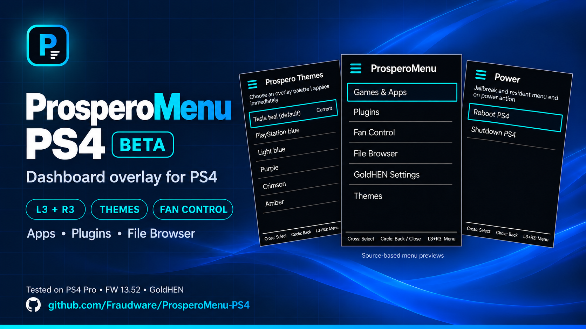

# ProsperoMenu PS4

PS4 dashboard overlay with app shortcuts, plugin controls, file browsing, fan controls, and themes.

**Beta — tested on PS4 Pro running firmware 13.52 with GoldHEN.**

[Download Beta](../../releases) · [Installation Guide](INSTALL.md) · [Report an Issue](../../issues)

## Features

| Feature | Description |
|---|---|
| Games & Apps | Launch titles from the included catalog |
| Plugins | View and toggle configured plugins |
| File Browser | Browse files and request package installation with confirmation |
| Fan Control | Adjust fan temperature triggers |
| Themes | Change overlay colors or open PS4 theme settings |
| GoldHEN Settings | Open settings from the menu |
| Power | Restart or shut down with confirmation |
| Cheats | Browse cheat filenames and view GoldHEN cheat-menu guidance |

## Compatibility

Tested on **PS4 Pro running firmware 13.52 with GoldHEN**. Compatibility with other firmware versions has not been verified.

The current beta loader checks for firmware 13.52 and rejects other versions.

## Installation

The beta contains two `.prx` modules and a `.bin` starter payload. Prebuilt files are in `dist/`.

1. Transfer both modules using the exact paths and filenames in the [installation guide](INSTALL.md).
2. Run the starter payload with GoldHEN active.
3. Press **L3 + R3** to open the menu.

The keeper stages the menu module into the ShellUI sandbox. The overlay needs to be loaded again after restarting the console.

## Controls

| Button | Action |
|---|---|
| L3 + R3 | Open or close |
| D-pad Up / Down | Move selection |
| Cross | Select |
| Circle | Back or close |

## Beta status

- App launching uses a fixed catalog rather than a live list of installed titles.
- Complete package installation through the File Browser remains unverified.
- Plugin toggling can truncate long configuration lines or large files; a correction is pending.

Back up plugin configuration before testing. A failed overlay load can freeze the dashboard and require a reboot.

## Building

Requires Linux or WSL with clang, lld, gcc, and objcopy, plus the OpenOrbis PS4Toolchain, GoldHEN Plugins SDK, and PS4 payload SDK (`libPS4` tree).

Configure `OO_PS4_TOOLCHAIN`, `GOLDHEN_SDK`, and `PAYLOAD_SDK`, then run:

```sh
sh tests/run.sh
python3 tests/pkg_safety_host.py
make -B -j4
```

## Credits & license

Based on [**Prospero-Menu by StonedModder**](https://github.com/StonedModder/Prospero-Menu).

Released under **GPL-3.0-or-later**. See [LICENSE](LICENSE).
